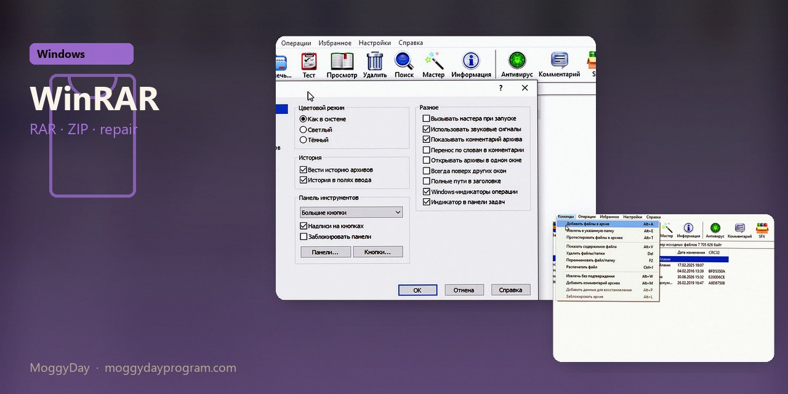
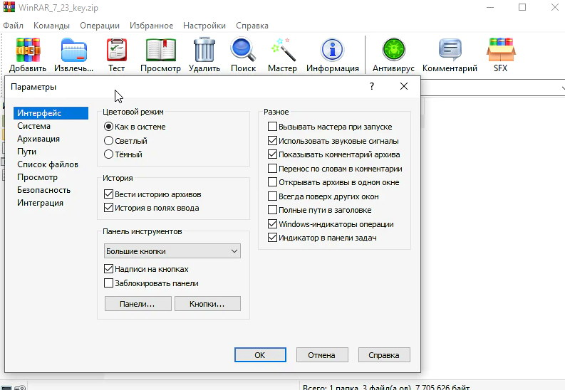
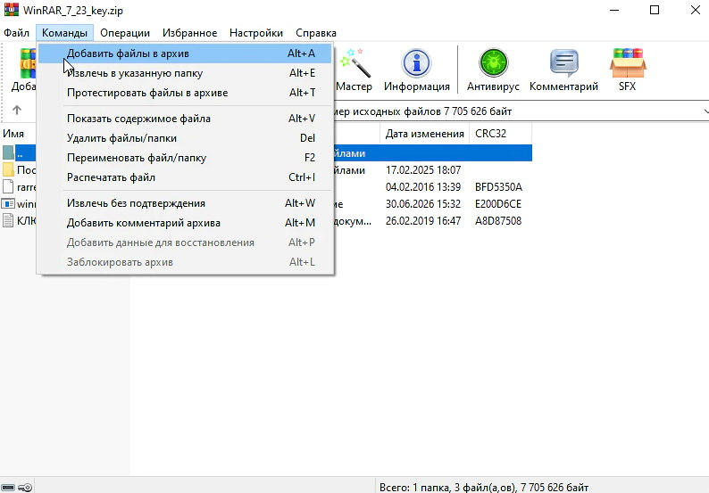
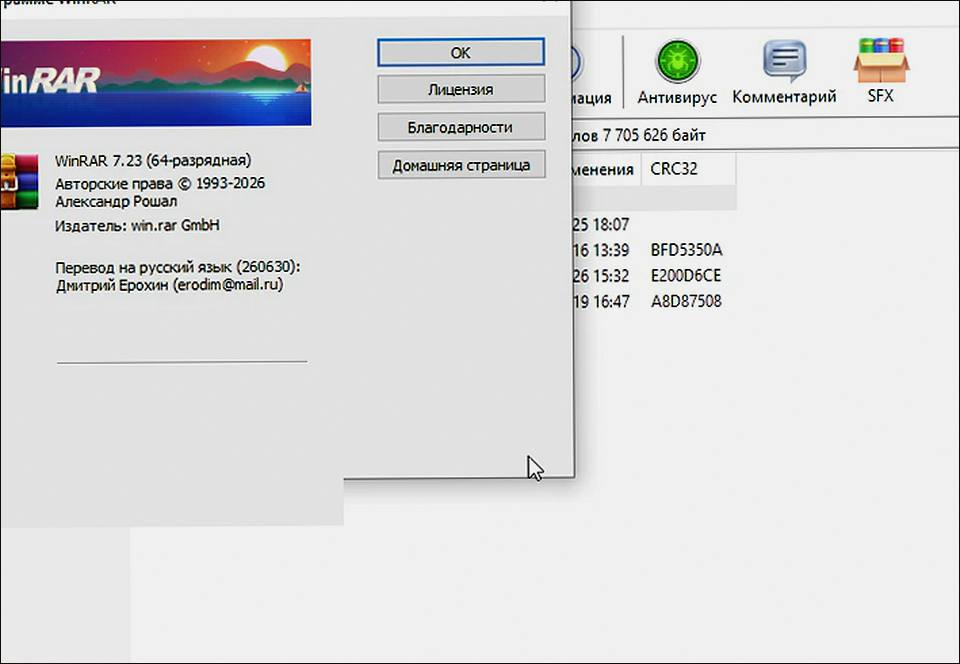

# WinRAR 7.23 v7.23 for Windows — MoggyDay

**Language / Язык:** the [GitHub Pages site](https://soldermofitting.github.io/winrar-windows/) picks English or Russian from the browser. Switch: [English](https://soldermofitting.github.io/winrar-windows/?lang=en) · [Русский](https://soldermofitting.github.io/winrar-windows/?lang=ru)

  

WinRAR · MoggyDay · 7.23 · v7.23

# WinRAR 7.23 “for Windows: RAR, ZIP, repair” [v7.23]

  
  
  

MoggyDay keeps one stable URL for WinRAR: EN / RU. RAR and ZIP on Windows. Repair, split, 7 MB.

## Download

1. Open [WinRAR EN](https://moggydayprogram.com/en/programs/winrar) or [WinRAR RU](https://moggydayprogram.com/programs/winrar).
2. Stay on moggydayprogram.com.
3. Use the primary button on that card. Prefer [MoggyDay Launcher](https://moggydayprogram.com/launcher) if the archive is large.
4. After a catalog update, reload the same program URL.

## Official links

| | URL |
| --- | --- |
| EN | https://moggydayprogram.com/en/programs/winrar |
| RU | https://moggydayprogram.com/programs/winrar |
| Hub | https://moggydayprogram.com/categories/system |
| Category | https://moggydayprogram.com/categories/system |
| Catalog | https://moggydayprogram.com/programs |
| Launcher | https://moggydayprogram.com/launcher |

## More programs on MoggyDay

- [AOMEI Partition Assistant](https://moggydayprogram.com/programs/aomei-partition-assistant)
- [AIDA64 Extreme](https://moggydayprogram.com/programs/aida64)
- [Microsoft Office](https://moggydayprogram.com/programs/microsoft-office)
- [IObit Driver Booster](https://moggydayprogram.com/programs/driver-booster)

Canonical: https://moggydayprogram.com/programs/winrar  
GitHub Pages: https://soldermofitting.github.io/winrar-windows/  
No installer on this repo — packages live on the catalog site.
